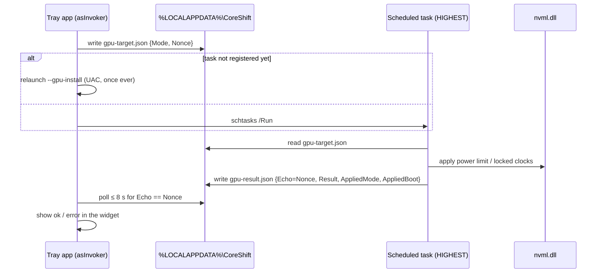

# CoreShift — Technical Specification

| | |
|---|---|
| **Product** | CoreShift |
| **Version** | 1.1.0 |
| **Platform** | Windows 10 (1809+) / Windows 11, x64 |
| **Runtime** | .NET 8 Desktop Runtime (framework-dependent) |
| **UI stack** | WPF (Windows Presentation Foundation) |
| **Distribution** | Inno Setup 6 installer, `CoreShift-Setup-1.1.0.exe` |

CoreShift is a system-tray utility that shifts a laptop between a **quiet/cool** profile and a
**full-performance** profile in one click, by controlling two independent knobs:

1. **CPU** — the Windows *Maximum processor state* (`PROCTHROTTLEMAX`), toggled 100% ↔ 99%.
   99% is the well-known trick that disables Intel/AMD Turbo Boost.
2. **GPU** — the NVIDIA discrete GPU power envelope, via NVML presets **BASE / LIGHT / HEAVY**.

---

## 1. Design goals & constraints

| ID | Goal | How it is met |
|----|------|---------------|
| G1 | Near-zero idle cost | Pure background process; widget rendered on demand; working set trimmed on idle |
| G2 | Binary < 5 MB | Framework-dependent single-file publish → **2.43 MB** |
| G3 | No UAC prompt at boot | `asInvoker` manifest; GPU writes delegated to a pre-registered scheduled task |
| G4 | Coexist with vendor software | No ASUS ACPI/WMI paths touched; Armoury Crate keeps working |
| G5 | Elegant, native-feeling UI | Frameless WPF card, DirectX-accelerated hover animation, pure vector icons |
| G6 | Reversible / safe | Every change is a documented OS-level setting; GPU caps auto-reset on reboot |

**Non-goals:** overclocking, voltage/undervolt control, fan-curve control, per-app profiles,
AMD/Intel discrete GPU support.

---

## 2. System requirements

| Component | Requirement |
|---|---|
| OS | Windows 10 1809+ or Windows 11, **x64** |
| Runtime | .NET 8 Desktop Runtime (installer auto-detects and can install it) |
| CPU features | Any CPU exposing `SUB_PROCESSOR / PROCTHROTTLEMAX` (effectively all) |
| GPU features *(optional)* | NVIDIA dGPU with a driver providing `nvml.dll`. Without it, CPU toggling still works and the GPU row shows the NVML error |
| Privileges | Normal user for everything except **one** first-time GPU setup prompt |

---

## 3. Architecture

### 3.1 Process model

CoreShift ships as a single executable with **two distinct roles**, selected by command line:

| Invocation | Role | Elevation | Lifetime |
|---|---|---|---|
| `CoreShift.exe` | **Tray host** — the normal app | asInvoker | Until user exits |
| `CoreShift.exe --gpu-apply` | **Headless helper** — performs NVML writes | Elevated (via task) | ~1 s |
| `CoreShift.exe --gpu-install` | **One-time setup** — registers the task | Elevated (via UAC) | ~1 s |

The helper verbs are handled in `App.OnStartup` **before** the single-instance mutex is taken and
before any tray/UI object is created, so an elevated helper never collides with the running tray
instance and never draws a window.

### 3.2 Source layout

```
src/CoreShift/
  App.xaml(.cs)               Entry point, CLI verb dispatch, tray icon, single-instance guard
  MainWindow.xaml(.cs)        Frameless widget, hover animations, dismiss-on-deactivate
  app.manifest                asInvoker + PerMonitorV2 DPI + Win10/11 compatibility
  ViewModels/
    MainViewModel.cs          All observable state; INotifyPropertyChanged for DataTriggers
  Services/
    PowerService.cs           CPU: powercfg query/set (silent)
    GpuPowerService.cs        GPU: NVML bindings, elevation handshake, presets
    StartupService.cs         HKCU\...\Run registration
    TrayPositioner.cs         Bottom-right geometry via SystemParameters.WorkArea
    MemoryUtil.cs             Working-set trimming
  Assets/CoreShift.ico        Multi-resolution icon (16-128 px DIB + 256 px PNG)
installer/CoreShift.iss       Inno Setup script (+ .NET runtime check, uninstall cleanup)
build/                        generate-icon.ps1, publish.ps1, build-installer.ps1
```

### 3.3 Threading model

- All UI state lives on the **WPF dispatcher thread**.
- Every OS interaction (`powercfg`, `schtasks`, NVML) runs on a **thread-pool thread** via
  `Task.Run`, awaited from the dispatcher — the UI never blocks on a process or driver call.
- `MainViewModel.IsBusy` serialises user actions: a second click is ignored while one is in flight.

---

## 4. Functional specification

### FR-1 — CPU power toggle

**Component:** `Services/PowerService.cs`

*Read* (`GetMaxProcessorStateAsync`):

```
powercfg /q SCHEME_CURRENT SUB_PROCESSOR PROCTHROTTLEMAX
```

Parses `Current AC Power Setting Index: 0x000000xx` (hex → int). Falls back to the `DC` line if
the `AC` line is absent. Returns `null` on non-zero exit or unparsable output.

*Write* (`SetMaxProcessorStateAsync`), value clamped to `1..100`:

```
powercfg /setacvalueindex SCHEME_CURRENT SUB_PROCESSOR PROCTHROTTLEMAX <percent>
powercfg /setdcvalueindex SCHEME_CURRENT SUB_PROCESSOR PROCTHROTTLEMAX <percent>
powercfg /setactive SCHEME_CURRENT
```

Success = AC write **and** `setactive` both exit 0. On failure the combined `stderr` is surfaced;
if empty, a generic "try running as administrator" hint is used.

All processes: `CreateNoWindow = true`, `UseShellExecute = false`, both streams redirected — no
console window ever flashes.

| App state | Value | Meaning |
|---|---|---|
| **Coding Mode** | 100 | Turbo Boost ON — full clocks |
| **Gaming Mode** | 99 | Turbo Boost OFF — cooler, quieter, steadier |

`IsCodingMode` is defined as `MaxProcessorState >= 100`, so any externally-set value below 100
renders as Gaming Mode. Toggling always targets exactly 99 or 100.

> `PROCTHROTTLEMAX` is hidden in the Control Panel UI by default. `powercfg` reads and writes it
> regardless, so CoreShift never needs to un-hide it.

---

### FR-2 — GPU power presets

**Component:** `Services/GpuPowerService.cs`

#### 4.2.1 Modes

| Mode | Intent | Power-limit target | Locked-clock fallback |
|---|---|---|---|
| `Base` | Remove CoreShift's cap; vendor software governs | vBIOS maximum | reset (unlocked) |
| `Light` | Light sessions (browsing, video, IDE) | **50 W** (clamp 40–60) | 210 – **990 MHz** (clamp 400–1300) |
| `Heavy` | Heavy sessions (gaming, render) | **70 W** (clamp 60–80) | 210 – **1402 MHz** (clamp 1000–2000) |
| `Custom` | Sentinel — no preset applied this boot | — | — |

#### 4.2.2 Knob-selection chain

The **software power limit** is preferred because it is a true wattage cap. Many laptop vBIOSes
reject it with `NVML_ERROR_NOT_SUPPORTED (3)`, so CoreShift falls back to **locked GPU clocks**
(the `nvidia-smi -lgc` API), which reaches a comparable thermal envelope.

```
LIGHT / HEAVY:
  1. nvmlDeviceGetPowerManagementLimitConstraints  → clamp target watts into [min,max]
  2. nvmlDeviceSetPowerManagementLimit             → success? also ResetLockedClocks, method="power"
  3. otherwise nvmlDeviceSetGpuLockedClocks(210, maxMhz) → success? method="clock"
  4. otherwise → report the NVML error string

BASE:
  1. nvmlDeviceResetGpuLockedClocks
  2. nvmlDeviceSetPowerManagementLimit(vBIOS max)
  → succeeds if EITHER knob reset (each may be unsupported)
```

The two caps are never stacked: applying the power limit also resets locked clocks.

#### 4.2.3 NVML binding

Device index **0** is always used. Functions imported from `nvml.dll`:

`nvmlInit_v2`, `nvmlShutdown`, `nvmlDeviceGetHandleByIndex_v2`,
`nvmlDeviceGetPowerManagementLimit`, `nvmlDeviceGetPowerManagementLimitConstraints`,
`nvmlDeviceSetPowerManagementLimit`, `nvmlDeviceGetClockInfo`,
`nvmlDeviceSetGpuLockedClocks`, `nvmlDeviceResetGpuLockedClocks`, `nvmlErrorString`.

**DLL resolution.** On laptop drivers `nvml.dll` is *not* in `System32`; it lives in the active
driver's DriverStore folder, whose name changes on every driver update. A custom
`NativeLibrary.SetDllImportResolver` therefore:

1. tries a plain `nvml.dll` load (works on desktop/datacenter drivers), then
2. scans `%SystemRoot%\System32\DriverStore\FileRepository\nv*\nvml.dll` and loads the
   **newest by last-write time**.

Error codes are mapped to actionable text: `3` → "this GPU's vBIOS refuses the change",
`4` → "the helper must run elevated".

Every NVML session is `Init → GetHandle(0) → body → Shutdown` with `Shutdown` in a `finally`.

#### 4.2.4 Elevation model (the core design decision)

NVML **reads** need no elevation; NVML **writes** do. Requiring elevation for the tray app would
mean a UAC prompt on every boot, violating G3. CoreShift therefore splits the two:

- The **tray app stays `asInvoker`** and only ever *reads* NVML → live data always visible.
- **Writes** are delegated to a Windows **scheduled task** `"CoreShift GPU Limit"` registered with
  `RunLevel HIGHEST`. Windows lets a task's own creator start it **without a new UAC prompt**, so
  only the very first setup shows one.

The task is created as `/SC ONCE /ST 00:00` — a trigger already in the past, so it **never fires on
its own**; it exists purely to be started on demand.

Coordination uses a **nonce handshake** through plain files:



The UI polls every 100 ms, up to 80 times (**8 s**), then reports
"GPU helper did not respond (task blocked?)".

> **Why files instead of `HKCU`?** An elevated task process is not guaranteed to see the same user
> registry hive (profile-less task starts, registry-virtualising sandboxes), whereas
> `%LOCALAPPDATA%` is one shared source of truth for both processes.

#### 4.2.5 Boot-session semantics

Both NVML knobs reset when the machine reboots. To avoid claiming a cap that no longer exists,
each result records a **boot stamp**:

```
BootStamp = (UtcNow − Environment.TickCount64) formatted "yyyyMMddHHmm"
```

Minute granularity absorbs clock jitter. If `gpu-result.json`'s `AppliedBoot` ≠ current boot stamp,
the applied mode is reported as `Custom` ("no preset this boot").

---

### FR-3 — Tray & widget lifecycle

| Phase | Behaviour |
|---|---|
| **1. Init** | Launched hidden (no `StartupUri`). `ShutdownMode=OnExplicitShutdown`. Tray icon registered. Single-instance mutex `CoreShift.SingleInstance.8F3A1C2E-…`; a second launch exits silently. |
| **2. Check** | Left-click → `MainViewModel.RefreshAsync()` reads CPU state (`powercfg`) **and** GPU state (NVML + applied-mode file). |
| **3. Render** | `TrayPositioner.PlaceBottomRight` sets `Left/Top` from `SystemParameters.WorkArea` (taskbar-aware, DIP units), then `Show()` + `Activate()`, `Topmost=true`. |
| **4. Act** | Toggle tile flips CPU 100↔99; GPU pills apply a preset. DataTriggers re-render instantly. |
| **5. Dismiss** | `OnDeactivated` → `Hide()`, then at `DispatcherPriority.Background`: `GC.Collect(2, Optimized, non-blocking)` + `MemoryUtil.TrimWorkingSet()`. |

The window instance is **reused** (hidden, not destroyed) for snappy re-show; the working-set trim
returns the physical pages regardless.

**Tray context menu:** `Open` · `Start with Windows` (checkable, reflects live registry state on
each open) · separator · `Exit`.

---

### FR-4 — Auto-start

**Component:** `Services/StartupService.cs`

| Item | Value |
|---|---|
| Key | `HKCU\Software\Microsoft\Windows\CurrentVersion\Run` |
| Value name | `CoreShift` |
| Value data | `"<full path to CoreShift.exe>"` (quoted) |
| First-run marker | `HKCU\Software\CoreShift` → `Initialized = "1"` |

`EnsureFirstRun()` injects the Run entry **once ever**. The marker means a user who later disables
auto-start is not silently re-enabled on the next launch. All registry work is best-effort and
wrapped in `try/catch` — it can never prevent the app from starting.

---

### FR-5 — Memory management

**Component:** `Services/MemoryUtil.cs` — `SetProcessWorkingSetSize(hProcess, -1, -1)`, the
documented "trim as much as possible" sentinel.

Called at `DispatcherPriority.ApplicationIdle` after startup, and after every dismissal.

Measured on Windows 11 (see §9).

---

## 5. Data & state reference

### 5.1 Files — `%LOCALAPPDATA%\CoreShift\`

| File | Written by | Schema | Purpose |
|---|---|---|---|
| `gpu-config.json` | Helper (seeded on first use) | `{ LightWatts, HeavyWatts, LightMaxMhz, HeavyMaxMhz }` | **User-tunable** preset values |
| `gpu-target.json` | Tray app | `{ Mode: "base"\|"light"\|"heavy", Nonce }` | Requested preset |
| `gpu-result.json` | Helper | `{ Echo, Result, AppliedMode, AppliedBoot }` | Outcome + applied-state memory |

`Result` is `"ok (power)"`, `"ok (clock)"`, or the NVML error text. Unreadable/corrupt files are
treated as absent.

Defaults seeded into `gpu-config.json`:

```json
{ "LightWatts": 50, "HeavyWatts": 70, "LightMaxMhz": 990, "HeavyMaxMhz": 1402 }
```

Values are re-clamped by the helper on every apply, so hand-edits cannot push the GPU outside the
supported band.

### 5.2 Registry

| Path | Value | Owner |
|---|---|---|
| `HKCU\Software\Microsoft\Windows\CurrentVersion\Run` | `CoreShift` | StartupService |
| `HKCU\Software\CoreShift` | `Initialized` | StartupService |

### 5.3 Scheduled task

| Property | Value |
|---|---|
| Name | `CoreShift GPU Limit` |
| Action | `"<exe path>" --gpu-apply` |
| Schedule | `ONCE` at `00:00` (already elapsed → never self-fires) |
| Run level | `HIGHEST` |
| Created by | `CoreShift.exe --gpu-install` (single UAC prompt, once ever) |

---

## 6. User-interface specification

### 6.1 Window

| Property | Value |
|---|---|
| Size | `276 × 392` DIP |
| Style | `WindowStyle=None`, `AllowsTransparency=True`, `Background=Transparent` |
| Behaviour | `ShowInTaskbar=False`, `ResizeMode=NoResize`, `Topmost=True` |
| Alt+Tab | Hidden via `WS_EX_TOOLWINDOW` applied in `OnSourceInitialized` |
| Rendering | `UseLayoutRounding`, `SnapsToDevicePixels`, ClearType, `FontFamily=Segoe UI` |
| Card | `Margin=16`, `CornerRadius=18`, 1 px `#262626` border, `DropShadowEffect` blur 26 / opacity 0.6 |

### 6.2 Palette

| Token | Hex | Use |
|---|---|---|
| Surface | `#121212` | Card background |
| Tile idle | `#1A1A1A` | Toggle tile & GPU pills at rest |
| Accent | `#1B5E20` | Hover fill |
| Accent text | `#66BB6A` | "SHIFT" wordmark, active pill border/text |
| Text primary | `#F5F5F5` | Titles, icons |
| Text secondary | `#9E9E9E` | Subtitles, GPU status |
| Error | `#EF5350` | Status line |
| Hairline | `#262626` | Card border |

### 6.3 Layout (4-row grid, 18 px padding)

1. **Wordmark** — `CORE` (primary) + `SHIFT` (accent), 13 px SemiBold.
2. **Toggle tile** — 60 × 60 vector icon, `ModeTitle` 17 px SemiBold, `ModeSubtitle` 11.5 px.
3. **GPU block** — `GpuStatusLine` 11.5 px, then a `UniformGrid` of 3 pills: `BASE` `LIGHT` `HEAVY`.
4. **Status line** — error text, 10.5 px, error colour; empty in the happy path.

### 6.4 Interaction & motion

| Element | Rest | Hover | Active |
|---|---|---|---|
| Toggle tile | `#1A1A1A`, radius 16 | `ColorAnimation` → `#1B5E20`, **180 ms** in / **220 ms** out | `Opacity 0.88` while pressed |
| GPU pill | `#1A1A1A`, radius 10, transparent 1.5 px border | same animation | `Tag="Active"` → accent border + accent text |

Animations run on WPF's DirectX composition thread — no CPU cost on the UI thread.

### 6.5 Icon swapping

Two `Viewbox` elements share a cell; `DataTrigger` on `IsCodingMode` shows exactly one:

- **True → PowerShell prompt** — two stroked `Path`s (chevron `M5,5 L13,12 L5,19` + underscore),
  2.4 px round caps.
- **False → Game controller** — one filled `Path`, `F1` (non-zero) fill rule.

### 6.6 GPU status line copy

| Condition | Text |
|---|---|
| NVML unavailable | `GPU · <actual NVML error>` |
| State not yet read | `GPU · …` |
| `Light` / `Heavy` | `GPU · <clock> MHz · capped` |
| `Base` | `GPU · <clock> MHz · Armoury Crate governs` |
| `Custom` | `GPU · <clock> MHz · no preset this boot` |

The real NVML error is shown deliberately — a bare "unavailable" would be undebuggable.

---

## 7. ViewModel surface

`MainViewModel : INotifyPropertyChanged`

| Member | Type | Notes |
|---|---|---|
| `MaxProcessorState` | `int` | Raises `IsCodingMode`, `ModeTitle`, `ModeSubtitle` |
| `IsCodingMode` | `bool` | `>= 100` |
| `ModeTitle` / `ModeSubtitle` | `string` | "Coding Mode" / "100% · Turbo Boost ON" |
| `IsBusy` | `bool` | Re-entrancy guard for both toggles |
| `StatusMessage` | `string` | Error surface |
| `GpuState` | `GpuState?` | `CurrentLimitWatts, MinWatts, MaxWatts, GraphicsClockMhz` |
| `CurrentGpuMode` | `GpuMode` | From `gpu-result.json` + boot stamp |
| `IsGpuBase/Light/Heavy` | `bool` | Drive pill `Tag="Active"` |
| `GpuStatusLine` | `string` | See §6.6 |
| `RefreshAsync()` | `Task` | CPU + GPU read |
| `ToggleAsync()` | `Task` | CPU 100 ↔ 99 |
| `SetGpuModeAsync(GpuMode)` | `Task` | Apply preset |

---

## 8. Error handling

| Failure | Surfaced as | Fatal? |
|---|---|---|
| `powercfg` read fails | Value unchanged; no message | No |
| `powercfg` write fails | `stderr` in the status line, or admin hint | No |
| NVML missing / driver absent | Real NVML error in the GPU status line | No — CPU features unaffected |
| vBIOS refuses power limit (`3`) | Automatic fallback to locked clocks | No |
| UAC declined at GPU setup | "Setup cancelled — GPU limits need one-time admin approval." | No |
| Helper task doesn't respond in 8 s | "GPU helper did not respond (task blocked?)." | No |
| Registry write fails | Silently ignored (`try/catch`) | No |

**Principle:** no failure path terminates the process or blocks the UI. A broken GPU stack must
never prevent the CPU toggle from working.

---

## 9. Performance characteristics

Measured on Windows 11, .NET 8.0.28:

| Metric | Value |
|---|---|
| Published executable | **2.43 MB** (framework-dependent, single-file) |
| Installer | **2.78 MB** |
| Working set — after launch | ~78 MB |
| **Working set — resting in tray (post-trim)** | **~1–3 MB** |
| Private bytes (real committed) | **~32 MB** (the .NET + WPF floor) |
| Idle CPU | 0% (fully event-driven; no timers, no polling) |

`ConcurrentGarbageCollection=false` and `InvariantGlobalization=true` were A/B-measured as
**neutral** for private bytes; they are kept for fewer background threads and faster startup.

---

## 10. Build & release

| Property | Value |
|---|---|
| TFM | `net8.0-windows` |
| RID | `win-x64` |
| Publish | `--self-contained false -p:PublishSingleFile=true -p:DebugType=none` |
| Dependency | `H.NotifyIcon.Wpf` **2.3.2** — pinned: the newest stable with a native `net8.0-windows` target (2.4.x targets net10 and would silently fall back to .NET Framework assets) |

```powershell
build\build-installer.ps1     # icon → single-file exe → installer_output\CoreShift-Setup-1.1.0.exe
```

**Version bump checklist:** `<Version>/<FileVersion>/<AssemblyVersion>` in `CoreShift.csproj`
**and** `MyAppVersion` in `installer/CoreShift.iss` — they are independent and must be kept in sync.

### Installer behaviour

- Installs to `{autopf}\CoreShift`, admin privileges, x64 only.
- **Runtime gate:** `PrepareToInstall` looks for
  `%ProgramFiles%\dotnet\shared\Microsoft.WindowsDesktop.App\8.*`; if absent it offers to download
  and silently install the official .NET 8 Desktop Runtime (exit `3010` → reboot flagged).
- **Uninstall cleanup:** `HKCU` Run value, `HKCU\Software\CoreShift`, the
  `CoreShift GPU Limit` scheduled task, and the three `%LOCALAPPDATA%\CoreShift` JSON files.

---

## 11. Known limitations

1. **NVIDIA only.** GPU presets require NVML. AMD/Intel discrete GPUs are unsupported; the CPU
   toggle is unaffected.
2. **First GPU use needs one UAC approval.** Unavoidable: NVML writes require elevation.
3. **GPU caps do not survive reboot.** Both NVML knobs are volatile by design; the applied mode is
   deliberately scoped to one boot session.
4. **Locked-clock fallback is an approximation.** The MHz defaults target a 100–140 W-class mobile
   GPU; on very different silicon, tune `gpu-config.json`.
5. **Multi-monitor / mixed DPI.** `SystemParameters.WorkArea` is primary-monitor based, so the
   widget always appears on the primary display.
6. **Single GPU.** Device index 0 only.
7. **Uninstall of per-user GPU state is best-effort.** On multi-account machines the JSON files of
   accounts other than the uninstalling one may remain.

---

## 12. Version history

### 1.1.0
- **Added** GPU power presets (BASE / LIGHT / HEAVY) via NVML, with power-limit → locked-clock
  fallback, an elevation-free scheduled-task helper, and per-boot applied-state tracking.
- **Added** `--gpu-apply` / `--gpu-install` headless CLI verbs.
- **Added** uninstall cleanup for the GPU scheduled task and `%LOCALAPPDATA%` state.
- **Changed** widget height 304 → 392 DIP for the GPU row.

### 1.0.0
- Initial release: CPU Coding/Gaming toggle, tray widget, auto-start, working-set trimming,
  Inno Setup installer with .NET runtime detection.
